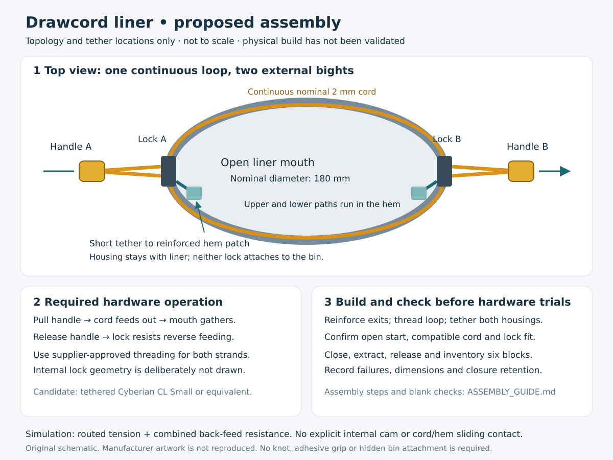

# Tethered drawcord liner: assembly and physical preflight

**Status: proposed physical construction, not a hardware-validated assembly.** The drawing describes cord topology and tether function. It is not a manufacturer's internal threading diagram. No real manual or robot demonstration is claimed. The simulation and its full geometry recordings remain the demonstrated evidence.

## Parts and preparation

Use the complete dimensions/placement table in [PHYSICAL_PROTOCOL.md](PHYSICAL_PROTOCOL.md): a secured 186 mm internal-diameter bin; a 172 mm body / 180 mm mouth / 250 mm tall, nominal 0.10 mm polyethylene liner; nominal 2 mm braided drawcord; two 18 x 14 x 24 mm, 6 g handles; two pull-to-tighten cord locks; and six clean 25 g blocks. Reinforcement patches, hem and short tethers are part of the custom liner assembly, not separate robot tools. Their construction must be recorded in the physical build log because it is not calibrated by the simulation.

The candidate lock is ITW Nexus Cyberian CL Small 350-8200 (23.8 x 16 x 7.4 mm), or an equivalent tethered pull-to-tighten design. The manufacturer confirms pull-cord tightening with a separately operated release: https://eu.itwnexus.com/content/cyberian-cordloc . This does not establish that this exact two-strand, 2 mm cord pairing will hold the assembled liner. Confirm compatible strand count, cord diameter, tether attachment and threading against the supplied lock instructions before assembly. Do not substitute a plunger lock that must be held open during tightening.

## Assembly

1. Make a continuous mouth hem in the liner with two opposed exits. Keep both half-circumference channels open. Reinforce the exits so the lock tethers load the hem rather than an unreinforced film edge. Record the hem method, patch dimensions/material and tether length in the build log; they remain unvalidated construction parameters.
2. Route one continuous cord along this closed path: **handle A bight → exit A → first half of hem → exit B → handle B bight → exit B → second half of hem → exit A → handle A bight**. Each handle holds an external bight; neither handle is fixed to the bin or table. There is no knot around the bag neck. A splice joining cord ends, if needed, must remain outside the sliding hem/lock passages and be documented.
3. Attach one lock housing to each reinforced exit with a short tether that remains attached to the liner, not to the bin. Route both local bight legs through a manufacturer-approved compatible lock arrangement so pulling the handle increases the external bight length and removes slack from the hem, while reverse feed is resisted when the handle is released. The drawing deliberately does not invent internal cam/threading geometry.
4. Fit the liner into the bin without clamping its rim. Place the six blocks as specified. Lay handles at `(0.22, ±0.22, 0.762)` m with the neck open. Measure the actual full cord route in this configuration; add the required joining allowance. The simulator uses route length plus 2 mm numerical slack; **2 mm is not a validated hardware cutting tolerance**. Adjust physical bights to achieve the specified start without pre-cinching.
5. Pull both handles by hand. Confirm the mouth gathers while the lock housings stay tethered at the exits. Release the handles: closure must hold without continuing hand support. Then lift using the two handles, clear the bin and place/release on the table. A failure requires correcting or replacing the physical assembly; do not disguise it by tightening the simulator's force constants.

## Manual validation to record before claiming hardware reproduction

This is a proposed verification procedure; the following results are **not yet measured**. Record an uninterrupted overhead and side view with a ruler in plane and keep the same assembly throughout. Reset fully for each of three proposed repeats. Report every repeat, including failures; three repeats would demonstrate local repeatability, not a statistical reliability estimate.

| Check | Record | Present status |
|---|---|---|
| Build | Lock make/part; cord brand/diameter; hem/patch method and dimensions; tether length; total cord route and free bight lengths; total filled mass | Not performed |
| Start | Mouth ≥100 mm; six 25 g blocks inside; handles at listed positions; no preclosure or hidden support | Not performed |
| Close | Minimum opening ≤50 mm and final opening ≤60 mm; optional measured pull force with device/range stated | Not performed |
| Extract | Whole load clears the rim or bin side by ≥20 mm; no block crosses the mouth/film | Not performed |
| Release | Whole load ≥20 mm inside table edges; bottom within 25 mm of top; no support by hands; bounds change ≤10 mm for 2 s | Not performed |
| Inspect/reset | Six contents recovered; film, hem and tethers intact; locks release and restore the open state | Not performed |

Apply the same [ruler/video scoring](PHYSICAL_PROTOCOL.md#rulervideo-scoring) to robot trials, including the ≥60 mm gripper-clearance requirement. Manual preflight validates assembly function only and cannot replace the YAM feasibility demonstration.

## What the simulator represents

`SlidingDrawcord` in `drawcord_physics_v37.py` routes the continuous cord through 20 dynamic hem markers: A → markers 5…15 → B → markers 15…19,0…5 → A. Visible housings are proxies. A global perimeter/back-feed force approximates their combined holding behaviour; individual internal lock motion and cord/hem sliding friction are not simulated. The closed bag, extraction and release arise from contact and forces, with no post-reset bag/content pose edits.
